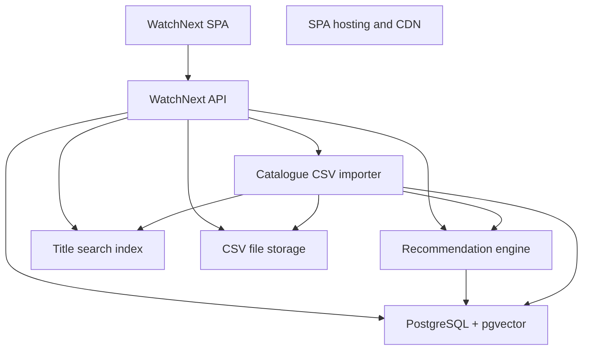
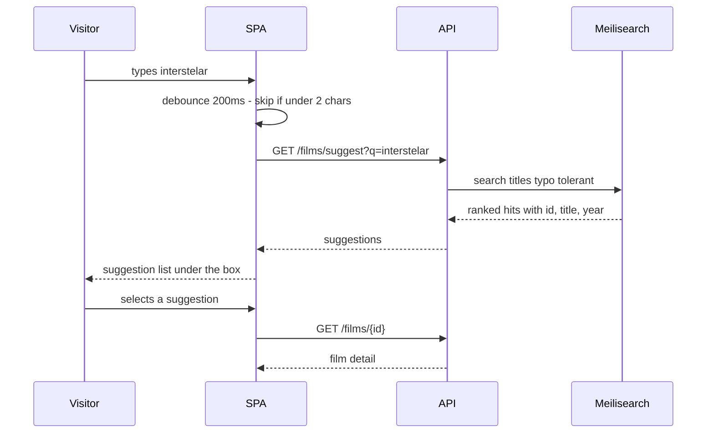
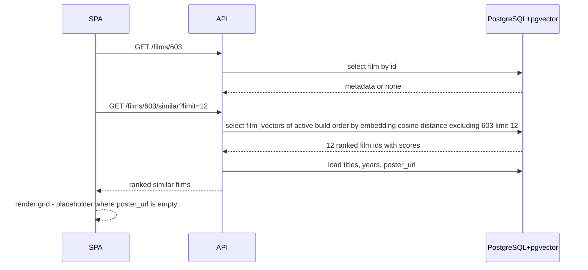
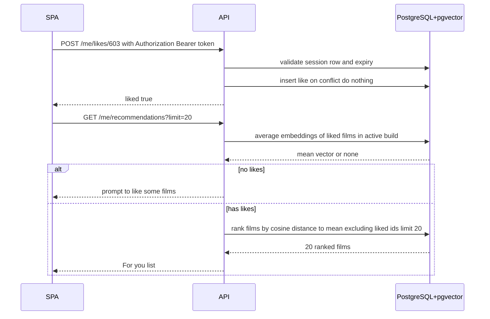
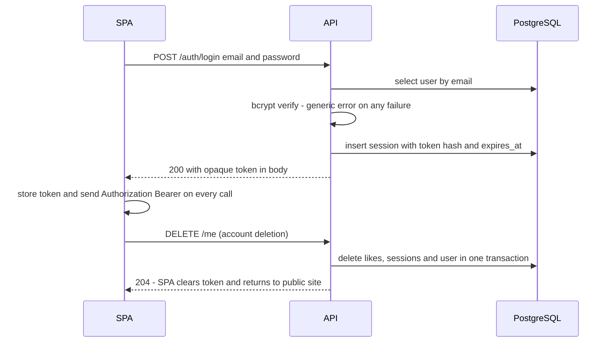
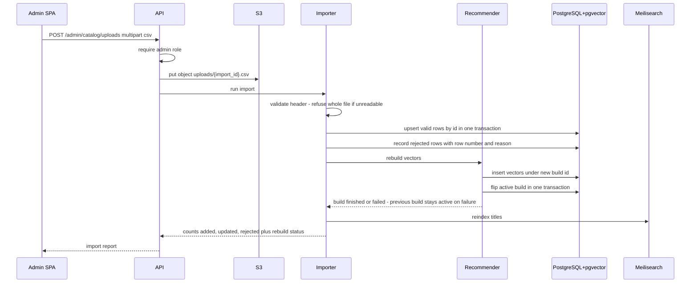
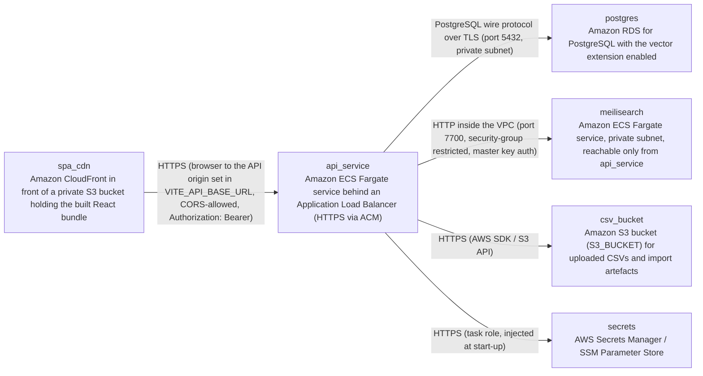

# Architecture

> Maintained by QuorQ AI SDLC. Text between `sdlc:auto` markers is regenerated; anything outside them is yours and is kept.

<!-- sdlc:auto:start narrative -->
## Overview

### ARCH-000 · approved · source: architecture:summary

WatchNext is a two-origin web application: a React 19 SPA served from S3/CloudFront and a FastAPI 0.115 container API on AWS, backed by one PostgreSQL 16 database with pgvector. The API holds the whole product in one Python codebase. Meilisearch provides title search; S3 holds uploaded CSVs and import reports.

Approved architecture, version 1.

- Two origins: React 19 SPA (static bundle on S3/CloudFront) and FastAPI 0.115 API (container on AWS).
- One Python codebase in the API covers: public catalogue and search endpoints, session-based account features, the admin CSV importer, and the scikit-learn TF-IDF soup builder plus cosine ranker.
- Film metadata and precomputed per-film similarity vectors live in PostgreSQL 16 + pgvector. Vectors are capped at 1024 TF-IDF features so they stay indexable.
- Because vectors are precomputed, 'similar films' and 'For you' are pure vector reads, not per-request maths.
- film_vectors is build-versioned: an in-flight or failed rebuild never removes the vectors currently being served.
- Meilisearch holds a lightweight title index for typo-tolerant search and two-character autocomplete.
- Uploaded CSV files and their import reports are parked in Amazon S3.
- Sign-in uses an opaque server-side session token returned in the login response body and sent as `Authorization: Bearer` on every call. Cookies cannot be used because the SPA and the API are on different hosts.
- Passwords stored as bcrypt hashes. Account deletion cascades to likes and sessions.
- Catalogue upload is gated on the admin role, which is only ever granted directly in the database.

**Related:** ARCH-C01, ARCH-C02, ARCH-C03, ARCH-C04, ARCH-C05, ARCH-C06, ARCH-C07, ARCH-TEC-001, ARCH-TEC-002, ARCH-TEC-003, ARCH-TEC-004

### ARCH-C01 · approved · source: architecture:component:web_app

WatchNext SPA, built with React 19. Responsive single-page UI covering search, film detail, recommendation grids, likes, account settings and the admin CSV upload page.

Technology: React 19.

Responsibilities:
- Search box with autocomplete.
- Film detail pages.
- Similar-film and For-you grids.
- One reusable Like control.
- Liked-films list.
- Account settings.
- Admin CSV upload page with its progress display and import report.

Integration:
- Reads the API base URL from `VITE_API_BASE_URL`.
- Attaches the stored session token as an `Authorization: Bearer` header.

**Related:** ARCH-C02, ARCH-C03, ARCH-TEC-001

### ARCH-C02 · approved · source: architecture:component:static_hosting

SPA hosting and CDN on AWS, using an S3 static website bucket behind CloudFront. Serves the built SPA bundle from its own origin, separate from the API origin.

Technology: AWS (S3 static website bucket behind CloudFront).

- Serves the built SPA bundle to anonymous and signed-in visitors worldwide.
- Runs on its own origin, separate from the API origin — this two-origin split is what rules out cookies and drives the bearer-token session design.

**Related:** ARCH-C01, ARCH-NODE-001

### ARCH-C03 · approved · source: architecture:component:api

WatchNext API built on FastAPI 0.115 (Python 3.12, uvicorn). Single HTTP API for search, film detail, similar films, likes, For-you, authentication, account deletion and admin catalogue upload.

Technology: FastAPI 0.115 (Python 3.12, uvicorn).

Surface:
- Search, film detail, similar films.
- Likes and For-you.
- Signup / sign-in / sign-out.
- Account deletion.
- Admin catalogue upload.

Cross-cutting responsibilities:
- Owns session issue and validation.
- Owns role checks.
- Applies CORS for the SPA origin.

**Related:** ARCH-C01, ARCH-C04, ARCH-C05, ARCH-API-001, ARCH-API-002, ARCH-API-003, ARCH-API-004, ARCH-API-005, ARCH-TEC-002

### ARCH-C04 · approved · source: architecture:component:recommender

Recommendation engine: a Python module inside the FastAPI service using scikit-learn and pgvector. Builds a weighted text soup per film, fits a TF-IDF vectoriser capped at 1024 features, and answers similar-film and For-you queries by cosine distance against stored vectors only.

Technology: Python module inside the FastAPI 0.115 service (scikit-learn, pgvector).

- Builds each film's weighted text soup: genres, director and cast repeated above plot.
- Fits a TF-IDF vectoriser capped at 1024 features.
- Writes one vector per film into pgvector under a build version.
- Answers similar-film and For-you queries by cosine distance against stored vectors only — no per-request vectorisation.

**Related:** ARCH-C03, ARCH-C05, ARCH-DATA-004, ARCH-FLOW-002, ARCH-FLOW-003

### ARCH-C05 · approved · source: architecture:component:catalog_importer

Catalogue CSV importer: a Python module inside the FastAPI service using pandas and boto3. Validates and parses the uploaded CSV, upserts valid rows by movie id inside a transaction, records rejected rows, then triggers the vector rebuild and the Meilisearch reindex.

Technology: Python module inside the FastAPI 0.115 service (pandas, boto3).

Sequence of responsibilities:
1. Validates the uploaded CSV header.
2. Parses rows.
3. Rejects and records bad rows by row number.
4. Upserts valid rows into `films` by movie id inside a transaction.
5. Never deletes absent films or user likes.
6. Triggers the vector rebuild.
7. Reindexes titles in Meilisearch.
8. Writes the import report.

**Related:** ARCH-C03, ARCH-C04, ARCH-C06, ARCH-C07, ARCH-DATA-005, ARCH-FLOW-005

### ARCH-C06 · approved · source: architecture:component:db

PostgreSQL 16 with the vector extension, hosted on Amazon RDS. System of record for users, sessions, films, likes, vector builds, film vectors and import reports, and the place cosine ranking is executed.

Technology: PostgreSQL 16 with the vector extension (Amazon RDS).

- System of record for: users, sessions, films, likes, vector builds, film vectors, import reports.
- Enforces transactional upserts.
- Enforces foreign keys.
- Enforces the one-like-per-user-per-film constraint.
- Performs cosine ranking through pgvector.

**Related:** ARCH-DATA-001, ARCH-DATA-002, ARCH-DATA-003, ARCH-DATA-004, ARCH-DATA-005, ARCH-NODE-003, ARCH-TEC-003

### ARCH-C07 · approved · source: architecture:component:search_index

Title search index on Meilisearch (container getmeili/meilisearch:v1.10.3). Typo-tolerant, prefix-matching index of film id, title and year, rebuilt or synced after each catalogue import.

Technology: Meilisearch (container getmeili/meilisearch:v1.10.3).

- Indexes film id, title and year only.
- Typo-tolerant and prefix-matching.
- Backs the search results page and the two-character autocomplete.
- Rebuilt/synced after each catalogue import.

**Related:** ARCH-C05, ARCH-FLOW-001, ARCH-NODE-004

### ARCH-C08 · approved · source: architecture:component:object_store

CSV file storage on Amazon S3. Stores each uploaded CSV under its import id so the importer can stream it and so the original file and its report remain available.

Technology: Amazon S3 (AWS).

- Stores each uploaded CSV under its import id.
- Lets the importer stream the file rather than hold it in memory.
- Keeps the original file and its report available for checking or re-running an upload.

**Related:** ARCH-C05, ARCH-NODE-005

### ARCH-FLOW-001 · approved · source: architecture:critical_path:Title search and autocomplete

Critical path for title search and autocomplete. From two characters typed, the SPA debounces and calls the suggest endpoint, which queries Meilisearch for typo-tolerant prefix matches. Both search and suggest are public endpoints.

- A visitor types in the search box.
- From two characters, the SPA debounces and calls the suggest endpoint.
- Suggest queries Meilisearch for typo-tolerant prefix matches and returns id, title and year.
- Full search uses the same index with a larger page size.
- No result produces an empty-state message, never an error.
- Both endpoints are public (no session required).

**Related:** ARCH-C01, ARCH-C03, ARCH-C07, ARCH-API-002

### ARCH-FLOW-002 · approved · source: architecture:critical_path:Film detail with similar films

Critical path for the film detail page. Metadata loads from PostgreSQL and the 12 nearest neighbours are read by cosine distance against the active vector build, excluding the film itself. Missing films 404; unvectorised films return an empty list with a reason code.

- Opening a film loads its metadata from PostgreSQL.
- Loads its 12 nearest neighbours by cosine distance against the active vector build, excluding the film itself.
- A missing film returns 404 so the SPA can show the not-found page.
- A film with no vector in the active build returns an empty list with a reason code, so the page can explain that recommendations are not ready yet.
- Likes for the current user are flagged when a session token is present.

**Related:** ARCH-C03, ARCH-C04, ARCH-C06, ARCH-API-002, ARCH-DATA-004

### ARCH-FLOW-003 · approved · source: architecture:critical_path:Like a film and get the For you list

Critical path for liking films and the For-you list. The Like control flips optimistically and POSTs; the insert is idempotent on (user_id, film_id). For you ranks the catalogue by cosine distance to the mean vector of the viewer's liked films, excluding already-liked films.

- A signed-in viewer toggles Like from the detail page, search results or a similar list (one reusable control).
- The SPA flips the control optimistically and POSTs.
- The insert is idempotent on (user_id, film_id), so a repeat is a no-op.
- For you averages the vectors of the viewer's liked films in the active build and ranks the catalogue by cosine distance to that mean.
- Already-liked films are excluded. Default result size 20.
- No likes returns a prompt payload instead of a list.
- An anonymous caller gets 401 and the SPA shows the sign-in invitation.

**Related:** ARCH-C01, ARCH-C03, ARCH-C04, ARCH-API-003, ARCH-DATA-003

### ARCH-FLOW-004 · approved · source: architecture:critical_path:Signup, sign-in and session handling

Critical path for signup, sign-in and session handling. Opaque session tokens are returned in the response body and resolved per protected call; failures on sign-in are deliberately generic. Sign-out revokes the session and account deletion cascades likes and sessions.

Signup:
- Validates the email format and the minimum password length.
- Refuses a duplicate email with a sign-in message.
- Stores a bcrypt hash, creates a session and returns the opaque token in the body.

Sign-in:
- Compares the hash.
- Returns a generic failure for both an unknown email and a wrong password.

Session handling:
- Every protected call resolves the bearer token to a non-revoked, unexpired session row.
- Slides `last_seen_at` on each resolution.

Termination:
- Sign-out revokes the session row.
- Account deletion revokes all the user's sessions and cascades their likes, leaving films untouched.

**Related:** ARCH-C03, ARCH-API-001, ARCH-DATA-001

### ARCH-FLOW-005 · approved · source: architecture:critical_path:Admin CSV upload, merge and vector rebuild

Critical path for the admin catalogue upload. The API checks the admin role, stores the file in S3, validates the header, upserts valid rows in one transaction, records bad rows, rebuilds the TF-IDF vectors under a new build id and flips is_active atomically, then reindexes titles and returns the report.

1. An admin posts a multipart CSV.
2. The API checks the admin role.
3. The file is stored in S3 under the import id.
4. The header is validated — an unreadable file or missing header is refused with the catalogue unchanged.
5. Valid rows upsert into `films` by id in one transaction; absent films are left alone and no like is touched.
6. Bad rows are recorded with their row number and reason.
7. The rebuild fits TF-IDF over all film soups with `max_features=1024` and writes vectors under a new build id.
8. `is_active` is flipped in a single transaction — until that flip, readers keep serving the previous build; a failure leaves the previous build active.
9. Titles are pushed to Meilisearch.
10. The report is returned.

**Related:** ARCH-C05, ARCH-C04, ARCH-C06, ARCH-C07, ARCH-C08, ARCH-API-004, ARCH-DATA-004, ARCH-DATA-005

### ARCH-DATA-001 · approved · source: architecture:entities:users,sessions

Identity and session storage. `users` holds the account with its bcrypt password hash and role; `sessions` holds opaque server-side sessions with revocation and expiry fields.

users: id, email, password_hash, role, created_at
- Role is viewer or admin; admin is only ever granted directly in the database.
- Password stored as a bcrypt hash.

sessions: id, user_id, token_hash, created_at, last_seen_at, expires_at, revoked_at
- Token is opaque and server-side; only its hash is stored.
- `last_seen_at` slides on every resolved protected call.
- `revoked_at` is set on sign-out and on account deletion.

**Related:** ARCH-C06, ARCH-FLOW-004

### ARCH-DATA-002 · approved · source: architecture:entities:films

`films` is the catalogue table, populated only by admin CSV import. It carries the display metadata plus the derived `soup` text used by the TF-IDF vectoriser.

films: id, title, year, plot, genres, director, cast_members, poster_url, soup, created_at, updated_at

- Merged by movie id with INSERT ... ON CONFLICT (id) DO UPDATE inside a transaction.
- Films absent from an upload are never deleted.
- `soup` is the weighted text built from genres, director and cast repeated above plot.

**Related:** ARCH-C06, ARCH-C04, ARCH-C05

### ARCH-DATA-003 · approved · source: architecture:entities:likes

`likes` records one like per user per film and is the input to the For-you mean vector. The one-like-per-user-per-film constraint makes the PUT idempotent.

likes: id, user_id, film_id, created_at

- Unique on (user_id, film_id) — the database enforces one like per user per film, so a repeated PUT leaves exactly one like.
- `ON DELETE RESTRICT` on likes.film_id makes 'never destroy likes' a constraint rather than a convention.
- Likes cascade away when the owning account is deleted; films are untouched.

**Related:** ARCH-C06, ARCH-FLOW-003, ARCH-TEC-003

### ARCH-DATA-004 · approved · source: architecture:entities:vector_builds,film_vectors

Build-versioned vector storage. `vector_builds` tracks each rebuild and which one is active; `film_vectors` holds one pgvector embedding per film per build, so a failed or in-flight rebuild never disturbs what is being served.

vector_builds: id, import_id, status, is_active, feature_count, film_count, started_at, finished_at, error
- A unique partial index on `is_active` makes the rebuild swap atomic.
- `feature_count` reflects the TF-IDF cap of 1024 features.
- On failure the previous build stays active and `error` records the reason.

film_vectors: id, film_id, build_id, embedding
- One embedding per film per build, stored in pgvector.
- Reads for 'similar films' and 'For you' always target the active build.

**Related:** ARCH-C04, ARCH-C06, ARCH-FLOW-005

### ARCH-DATA-005 · approved · source: architecture:entities:catalog_imports,catalog_import_rows

Import bookkeeping. `catalog_imports` holds one row per upload with its S3 key, status and row counts; `catalog_import_rows` records each rejected row by number with a reason and a raw excerpt.

catalog_imports: id, admin_user_id, original_filename, s3_key, status, rows_added, rows_updated, rows_rejected, message, started_at, finished_at
- `s3_key` points at the uploaded CSV parked in S3 under the import id.
- Backs the progress poll and the final report.

catalog_import_rows: id, import_id, row_number, reason, raw_excerpt
- One row per rejected CSV row, identified by its row number with the reason and a raw excerpt.

**Related:** ARCH-C05, ARCH-C08, ARCH-FLOW-005, ARCH-API-004

### ARCH-API-001 · approved · source: architecture:endpoints:auth

Authentication endpoints: signup, login and logout. Signup and login both return the opaque session token in the response body; login failures are deliberately indistinguishable.

POST /auth/signup — Create a viewer account and start a session. Refuses a duplicate email with a sign-in message, and returns field-level errors for a malformed email or a password under the minimum length.

POST /auth/login — Exchange email and password for an opaque session token returned in the body. Any failure returns the same generic message.

POST /auth/logout — Revoke the current session immediately.

**Related:** ARCH-C03, ARCH-FLOW-004, ARCH-DATA-001

### ARCH-API-002 · approved · source: architecture:endpoints:catalogue

Public catalogue endpoints: search, suggest, film detail and similar films. Search and suggest are served from Meilisearch; similar films is a pgvector read against the active build.

GET /films/search — Typo-tolerant, substring title search over the catalogue. An empty result set returns an empty list, never an error.

GET /films/suggest — Autocomplete suggestions for the search box. Returns an empty list when `q` is shorter than two characters.

GET /films/{film_id} — Full film detail from the admin-uploaded catalogue. An unknown id returns 404 for the not-found page.

GET /films/{film_id}/similar — Films ranked by cosine similarity against the active vector build, excluding the film itself. Returns fewer than the limit when the catalogue is small, and an empty list with reason `not_vectorised_yet` when the film has no vector in the active build.

**Related:** ARCH-C03, ARCH-C07, ARCH-FLOW-001, ARCH-FLOW-002

### ARCH-API-003 · approved · source: architecture:endpoints:account

Signed-in account endpoints: account summary, account deletion, the liked-films list, like/unlike and the For-you recommendations. All require a resolved bearer session.

GET /me — Current account summary for the settings page, including the plain statement that only email, password hash and like history are stored.

DELETE /me — Delete the account, all its likes and all its sessions in one transaction, after the SPA's explicit confirmation step. The catalogue is untouched and the email becomes reusable.

GET /me/likes — Every film the signed-in viewer has liked, newest first, with title and year for the My liked films page.

PUT /me/likes/{film_id} — Like a film from anywhere in the UI. Idempotent: a repeat leaves exactly one like and returns 200.

DELETE /me/likes/{film_id} — Remove a like, making the film eligible for recommendation again.

GET /me/recommendations — For you: films ranked by cosine similarity to the mean vector of everything the viewer has liked, excluding already-liked films. With no likes it returns the prompt payload instead of a list.

**Related:** ARCH-C03, ARCH-FLOW-003, ARCH-FLOW-004, ARCH-DATA-003

### ARCH-API-004 · approved · source: architecture:endpoints:admin

Admin catalogue endpoints: upload a CSV, poll a single import's progress and report, and list recent imports. All are gated on the admin role.

POST /admin/catalog/uploads — Upload a catalogue CSV (id, title, year, plot, genres, director, cast, optional poster_url). Stores the file in S3, merges valid rows by movie id, records rejected rows, then rebuilds the similarity vectors and returns the report. Refuses an unreadable file or a missing header with the catalogue unchanged.

GET /admin/catalog/uploads/{import_id} — Poll an import's progress and read its final report, including the rebuild's start and finish times or its failure reason.

GET /admin/catalog/uploads — Recent imports with their outcomes, so an admin can check or re-run a previous upload.

**Related:** ARCH-C05, ARCH-FLOW-005, ARCH-DATA-005

### ARCH-API-005 · approved · source: architecture:endpoints:GET /health

Operational health endpoint used as the liveness and readiness probe for the API service.

GET /health — Liveness and readiness probe reporting database, pgvector and Meilisearch reachability.

**Related:** ARCH-C03, ARCH-NODE-002

### ARCH-NODE-001 · approved · source: architecture:deployment:spa_cdn

spa_cdn: Amazon CloudFront in front of a private S3 bucket holding the built React bundle.

Node: spa_cdn
- Platform: Amazon CloudFront in front of a private S3 bucket.
- Workload: static assets — the React 19 production build.

**Related:** ARCH-C01, ARCH-C02

### ARCH-NODE-002 · approved · source: architecture:deployment:api_service

api_service: Amazon ECS Fargate service behind an Application Load Balancer with HTTPS via ACM, running the FastAPI container.

Node: api_service
- Platform: Amazon ECS Fargate service behind an Application Load Balancer (HTTPS via ACM).
- Workload: Python 3.12 container running FastAPI 0.115 under uvicorn.
- Hosts the API, the in-process CSV importer and the in-process vector rebuild.

**Related:** ARCH-C03, ARCH-C04, ARCH-C05, ARCH-API-005

### ARCH-NODE-003 · approved · source: architecture:deployment:postgres

postgres: Amazon RDS for PostgreSQL 16 with the vector extension enabled.

Node: postgres
- Platform: Amazon RDS for PostgreSQL with the vector extension enabled.
- Workload: PostgreSQL 16.
- Noted in the cloud decision as providing automated backups.

**Related:** ARCH-C06, ARCH-TEC-003

### ARCH-NODE-004 · approved · source: architecture:deployment:meilisearch

meilisearch: an ECS Fargate service in a private subnet, reachable only from api_service, with an EFS volume for the index.

Node: meilisearch
- Platform: Amazon ECS Fargate service, private subnet, reachable only from api_service.
- Workload: container getmeili/meilisearch:v1.10.3 with an EFS volume for the index.
- Described in the cloud decision as a second, small Fargate task.

**Related:** ARCH-C07, ARCH-NODE-002

### ARCH-NODE-005 · approved · source: architecture:deployment:csv_bucket

csv_bucket: an S3 bucket (S3_BUCKET) for uploaded CSVs and import artefacts, encrypted with SSE-S3, public access blocked and versioning on.

Node: csv_bucket
- Platform: Amazon S3 bucket, referenced by the `S3_BUCKET` setting.
- Workload: object storage for uploaded CSVs and import artefacts.
- Controls: SSE-S3 encryption, public access blocked, versioning on.

**Related:** ARCH-C08, ARCH-FLOW-005

### ARCH-NODE-006 · approved · source: architecture:deployment:secrets

secrets: AWS Secrets Manager / SSM Parameter Store holding the database URL, Meilisearch master key, seed admin password and S3 credentials.

Node: secrets
- Platform: AWS Secrets Manager / SSM Parameter Store.
- Holds: `DATABASE_URL`, `MEILI_MASTER_KEY`, `SEED_ADMIN_PASSWORD`, and the AWS credentials for S3.

**Related:** ARCH-NODE-002, ARCH-NODE-003, ARCH-NODE-004, ARCH-NODE-005

### ARCH-TEC-001 · approved · source: architecture:decision:Frontend

Frontend: React 19, chosen over Vue 3, SvelteKit and server-rendered Jinja templates. The deciding factor was reusing one LikeButton across search results, similar-film grids and the film detail page as a single implementation.

Decision: React 19.
Alternatives considered: Vue 3, SvelteKit, server-rendered Jinja templates.

Rationale as stated:
- The design reuses one LikeButton component in search results, similar-film grids and the film detail page, each toggling optimistically against PUT/DELETE /me/likes/{film_id}; React's component model and local state make that a single implementation rather than three.
- The SPA is a static bundle on CloudFront.
- It reads the API host from `VITE_API_BASE_URL`.
- It holds the session token in memory with a localStorage fallback, attaching it as `Authorization: Bearer`.

**Related:** ARCH-C01, ARCH-C02, ARCH-FLOW-003

### ARCH-TEC-002 · approved · source: architecture:decision:Backend

Backend: FastAPI 0.115, chosen over Django REST Framework, Flask and Node.js/Express. Keeping API, importer and recommender in one Python process is what allows the rebuild to run inside the upload request now that a queue is out of scope.

Decision: FastAPI 0.115 (Python 3.12, uvicorn).
Alternatives considered: Django REST Framework, Flask, Node.js/Express.

Rationale as stated:
- One Python process for the API, the CSV importer and the TF-IDF/cosine recommender lets the rebuild run inside the upload request, now that the queue is out of scope: `import_service` calls `vectorizer` directly, with no serialisation boundary.
- FastAPI's dependency injection carries `current_user` and `require_admin` onto exactly the endpoints that need them.
- FastAPI's `UploadFile` streaming handles the multipart CSV.

**Related:** ARCH-C03, ARCH-C04, ARCH-C05, ARCH-FLOW-005

### ARCH-TEC-003 · approved · source: architecture:decision:Database

Database: PostgreSQL 16 with pgvector, chosen over MySQL 8, SQLite and MongoDB. One store holds relational data and the 1024-dimension vectors, so recommendations need no second store to keep in sync.

Decision: PostgreSQL 16 (with the vector extension).
Alternatives considered: MySQL 8, SQLite, MongoDB.

Rationale as stated:
- One database holds users, sessions, films, likes and the 1024-dimension vectors through pgvector, so recommendations need no second store to keep in sync.
- The merge rule is a single `INSERT ... ON CONFLICT (id) DO UPDATE` inside a transaction.
- `ON DELETE RESTRICT` on likes.film_id makes 'never destroy likes' a constraint rather than a convention.
- Build-versioned `film_vectors` plus a unique partial index on `is_active` make the rebuild swap atomic.

**Related:** ARCH-C06, ARCH-DATA-003, ARCH-DATA-004, ARCH-NODE-003

### ARCH-TEC-004 · approved · source: architecture:decision:Cloud

Cloud: AWS, chosen over Google Cloud, Azure and Fly.io. One account carries the whole topology, and the ALB plus CloudFront hosts are what make the two-origin, bearer-token design concrete.

Decision: AWS.
Alternatives considered: Google Cloud, Azure, Fly.io.

Rationale as stated — one account carries the whole topology:
- RDS PostgreSQL 16 with pgvector and automated backups.
- One Fargate task for the API and its in-process rebuild.
- A second small Fargate task for Meilisearch.
- S3 for the admin's CSVs behind the approved AWS keys.
- CloudFront for the SPA origin.
- The ALB and CloudFront hosts are what make the two-origin, bearer-token design concrete.

**Related:** ARCH-NODE-001, ARCH-NODE-002, ARCH-NODE-003, ARCH-NODE-004, ARCH-NODE-005, ARCH-NODE-006, ARCH-000
<!-- sdlc:auto:end narrative -->

<!-- sdlc:auto:start building-blocks -->
## Building Block View

| ID | Name | Technology | Responsibility | Depends on |
|---|---|---|---|---|
| web_app | WatchNext SPA | React 19 | Responsive single-page UI: search box with autocomplete, film detail pages, similar-film and For-you grids, one reusable Like control, liked-films list, account settings, and the admin CSV upload page with its progress and import report. Reads the API base URL from VITE_API_BASE_URL and attaches the stored session token as an Authorization: Bearer header. | api |
| static_hosting | SPA hosting and CDN | AWS (S3 static website bucket behind CloudFront) | Serves the built SPA bundle to anonymous and signed-in visitors worldwide from its own origin, separate from the API origin. | — |
| api | WatchNext API | FastAPI 0.115 (Python 3.12, uvicorn) | HTTP API for search, film detail, similar films, likes, For-you, signup/sign-in/sign-out, account deletion and admin catalogue upload. Owns session issue/validation and role checks, and applies CORS for the SPA origin. | db, search_index, recommender, catalog_importer, object_store |
| recommender | Recommendation engine | Python module inside the FastAPI 0.115 service (scikit-learn, pgvector) | Builds each film's weighted text soup (genres, director and cast repeated above plot), fits a TF-IDF vectoriser capped at 1024 features, writes one vector per film into pgvector under a build version, and answers similar-film and For-you queries by cosine distance against stored vectors only. | db |
| catalog_importer | Catalogue CSV importer | Python module inside the FastAPI 0.115 service (pandas, boto3) | Validates the uploaded CSV header, parses rows, rejects and records bad rows by row number, upserts valid rows into films by movie id inside a transaction, never deletes absent films or user likes, then triggers the vector rebuild and reindexes titles in Meilisearch. Writes the import report. | db, object_store, recommender, search_index |
| db | PostgreSQL + pgvector | PostgreSQL 16 with the vector extension (Amazon RDS) | System of record for users, sessions, films, likes, vector builds, film vectors and import reports. Enforces transactional upserts, foreign keys and the one-like-per-user-per-film constraint, and performs cosine ranking through pgvector. | — |
| search_index | Title search index | Meilisearch (container getmeili/meilisearch:v1.10.3) | Typo-tolerant, prefix-matching index of film id, title and year for the search results page and the two-character autocomplete. Rebuilt/synced after each catalogue import. | — |
| object_store | CSV file storage | Amazon S3 (AWS) | Stores each uploaded CSV under its import id so the importer can stream it and so the original file and its report stay available for checking or re-running. | — |

<!-- sdlc:auto:end building-blocks -->

<!-- sdlc:auto:start runtime -->
## Runtime View

### Title search and autocomplete

A visitor types in the search box. From two characters the SPA debounces and calls the suggest endpoint, which queries Meilisearch for typo-tolerant prefix matches and returns id, title and year. Full search uses the same index with a larger page size. No result produces an empty-state message, never an error. Both endpoints are public.

- **Components:** web_app, api, search_index, db
- **Modules:** web/src/features/search/SearchBox.tsx, web/src/features/search/useSuggestions.ts, api/routers/films.py, api/services/search_service.py, api/clients/meili.py
- **Key functions:** suggest_titles(q: str, limit: int = 8) -> list[FilmSummary], search_films(q: str, page: int, page_size: int) -> SearchPage, index_films(films: list[Film]) -> None

### Film detail with similar films

Opening a film loads its metadata from PostgreSQL and its 12 nearest neighbours by cosine distance against the active vector build, excluding the film itself. A missing film returns 404 for the not-found page. A film with no vector in the active build returns an empty list with a reason code so the page can explain that recommendations are not ready yet. Likes for the current user are flagged when a session token is present.

- **Components:** web_app, api, recommender, db
- **Modules:** web/src/pages/FilmPage.tsx, web/src/features/likes/LikeButton.tsx, api/routers/films.py, api/services/recommend_service.py, api/repositories/vector_repo.py
- **Key functions:** get_film(film_id: int, viewer_id: UUID \| None) -> FilmDetail, similar_films(film_id: int, limit: int = 12) -> list[ScoredFilm], active_build_id() -> UUID \| None

### Like a film and get the For you list

A signed-in viewer toggles Like from the detail page, search results or a similar list. The SPA flips the control optimistically and POSTs; the insert is idempotent on (user_id, film_id) so a repeat is a no-op. For you averages the vectors of the viewer's liked films in the active build and ranks the catalogue by cosine distance to that mean, excluding already-liked films, default 20. No likes returns a prompt payload instead of a list. An anonymous caller gets 401 and the SPA shows the sign-in invitation.

- **Components:** web_app, api, recommender, db
- **Modules:** web/src/features/likes/useLike.ts, web/src/pages/ForYouPage.tsx, api/routers/likes.py, api/routers/recommendations.py, api/services/recommend_service.py
- **Key functions:** add_like(user_id: UUID, film_id: int) -> Like, remove_like(user_id: UUID, film_id: int) -> None, for_you(user_id: UUID, limit: int = 20) -> list[ScoredFilm] \| NoLikesPrompt, mean_liked_vector(user_id: UUID, build_id: UUID) -> Vector \| None

### Signup, sign-in and session handling

Signup validates the email format and minimum password length, refuses a duplicate email with a sign-in message, stores a bcrypt hash, creates a session and returns the opaque token in the body. Sign-in compares the hash and returns a generic failure for both unknown email and wrong password. Every protected call resolves the bearer token to a non-revoked, unexpired session row and slides last_seen_at. Sign-out revokes the row; account deletion revokes all the user's sessions and cascades their likes, leaving films untouched.

- **Components:** web_app, api, db
- **Modules:** web/src/features/auth/AuthProvider.tsx, api/routers/auth.py, api/routers/account.py, api/security/passwords.py, api/security/sessions.py, api/deps.py
- **Key functions:** signup(email: str, password: str) -> SessionToken, login(email: str, password: str) -> SessionToken, logout(token: str) -> None, current_user(authorization: str) -> User, require_admin(user: User) -> User, delete_account(user_id: UUID) -> None

### Admin CSV upload, merge and vector rebuild

An admin posts a multipart CSV. The API checks the admin role, stores the file in S3 under the import id, then validates the header — an unreadable file or missing header is refused with the catalogue unchanged. Valid rows upsert into films by id in one transaction; absent films are left alone and no like is touched. Bad rows are recorded with their row number and reason. The rebuild then fits TF-IDF over all film soups with max_features=1024, writes vectors under a new build id, and flips is_active in a single transaction — until that flip, readers keep serving the previous build, and a failure leaves the previous build active. Finally titles are pushed to Meilisearch and the report is returned.

- **Components:** web_app, api, catalog_importer, recommender, object_store, db, search_index
- **Modules:** web/src/pages/admin/UploadPage.tsx, api/routers/admin_catalog.py, api/services/import_service.py, api/services/soup.py, api/services/vectorizer.py, api/clients/s3.py
- **Key functions:** upload_catalog(file: UploadFile, admin: User) -> ImportReport, validate_header(columns: list[str]) -> None, upsert_rows(rows: Iterable[dict]) -> MergeCounts, build_soup(film: Film) -> str, rebuild_vectors(max_features: int = 1024) -> VectorBuild, activate_build(build_id: UUID) -> None

<!-- sdlc:auto:end runtime -->

<!-- sdlc:auto:start deployment-view -->
## Deployment View

| Name | Service | Runtime | Scaling | Environment |
|---|---|---|---|---|
| spa_cdn | Amazon CloudFront in front of a private S3 bucket holding the built React bundle | Static assets (React 19 production build) | CDN-managed, no instances | dev |
| api_service | Amazon ECS Fargate service behind an Application Load Balancer (HTTPS via ACM) | Python 3.12 container running FastAPI 0.115 under uvicorn | 1 task in dev, 1 vCPU / 2 GB — the rebuild is CPU-bound and runs in-process, so the task is sized for it; horizontal scaling by task count later | dev |
| postgres | Amazon RDS for PostgreSQL with the vector extension enabled | PostgreSQL 16 | Single db.t4g.medium instance, 50 GB gp3, storage encrypted at rest, automated daily backups, 7-day PITR | dev |
| meilisearch | Amazon ECS Fargate service, private subnet, reachable only from api_service | Container getmeili/meilisearch:v1.10.3 with an EFS volume for the index | 1 task, 0.5 vCPU / 1 GB — index of 50,000 titles only | dev |
| csv_bucket | Amazon S3 bucket (S3_BUCKET) for uploaded CSVs and import artefacts | Object storage, SSE-S3 encryption, public access blocked, versioning on | Managed | dev |
| secrets | AWS Secrets Manager / SSM Parameter Store | Holds DATABASE_URL, MEILI_MASTER_KEY, SEED_ADMIN_PASSWORD and the AWS credentials for S3 | Managed | dev |

| Source | Target | Protocol |
|---|---|---|
| spa_cdn | api_service | HTTPS (browser to the API origin set in VITE_API_BASE_URL, CORS-allowed, Authorization: Bearer) |
| api_service | postgres | PostgreSQL wire protocol over TLS (port 5432, private subnet) |
| api_service | meilisearch | HTTP inside the VPC (port 7700, security-group restricted, master key auth) |
| api_service | csv_bucket | HTTPS (AWS SDK / S3 API) |
| api_service | secrets | HTTPS (task role, injected at start-up) |

<!-- sdlc:auto:end deployment-view -->

<!-- sdlc:auto:start decisions -->
## Architecture Decisions

| Layer | Choice | ADR |
|---|---|---|
| Frontend | React 19 | [ADR-0001](adr/frontend.md) |
| Backend | FastAPI 0.115 | [ADR-0002](adr/backend.md) |
| Database | PostgreSQL 16 | [ADR-0003](adr/database.md) |
| Cloud | AWS | [ADR-0004](adr/cloud.md) |
<!-- sdlc:auto:end decisions -->

<!-- sdlc:auto:start links -->
## Related Documents

- [Data Model](data-model.md)
- [API Specification](api/openapi.yaml)
- [Architecture Decision Records](adr/README.md)
<!-- sdlc:auto:end links -->
