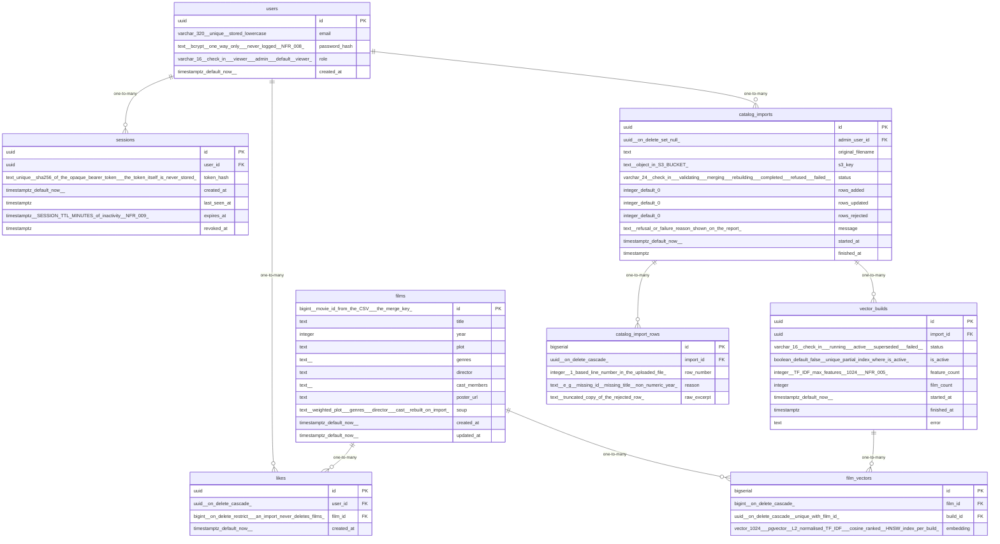

# Data Model

<!-- sdlc:auto:start entities -->
### users

| Field | Type | PK | FK | Nullable |
|---|---|---|---|---|
| id | uuid | True | — | False |
| email | varchar(320) unique, stored lowercase | False | — | False |
| password_hash | text (bcrypt, one-way only — never logged, NFR-008) | False | — | False |
| role | varchar(16) check in ('viewer','admin') default 'viewer' | False | — | False |
| created_at | timestamptz default now() | False | — | False |

### sessions

| Field | Type | PK | FK | Nullable |
|---|---|---|---|---|
| id | uuid | True | — | False |
| user_id | uuid | False | users.id | False |
| token_hash | text unique (sha256 of the opaque bearer token — the token itself is never stored) | False | — | False |
| created_at | timestamptz default now() | False | — | False |
| last_seen_at | timestamptz | False | — | False |
| expires_at | timestamptz (SESSION_TTL_MINUTES of inactivity, NFR-009) | False | — | False |
| revoked_at | timestamptz | False | — | True |

### films

| Field | Type | PK | FK | Nullable |
|---|---|---|---|---|
| id | bigint (movie id from the CSV — the merge key) | True | — | False |
| title | text | False | — | False |
| year | integer | False | — | True |
| plot | text | False | — | True |
| genres | text[] | False | — | True |
| director | text | False | — | True |
| cast_members | text[] | False | — | True |
| poster_url | text | False | — | True |
| soup | text (weighted plot + genres + director + cast, rebuilt on import) | False | — | True |
| created_at | timestamptz default now() | False | — | False |
| updated_at | timestamptz default now() | False | — | False |

### likes

| Field | Type | PK | FK | Nullable |
|---|---|---|---|---|
| id | uuid | True | — | False |
| user_id | uuid (on delete cascade) | False | users.id | False |
| film_id | bigint (on delete restrict — an import never deletes films) | False | films.id | False |
| created_at | timestamptz default now() | False | — | False |

### vector_builds

| Field | Type | PK | FK | Nullable |
|---|---|---|---|---|
| id | uuid | True | — | False |
| import_id | uuid | False | catalog_imports.id | True |
| status | varchar(16) check in ('running','active','superseded','failed') | False | — | False |
| is_active | boolean default false (unique partial index where is_active) | False | — | False |
| feature_count | integer (TF-IDF max_features, 1024 — NFR-005) | False | — | False |
| film_count | integer | False | — | True |
| started_at | timestamptz default now() | False | — | False |
| finished_at | timestamptz | False | — | True |
| error | text | False | — | True |

### film_vectors

| Field | Type | PK | FK | Nullable |
|---|---|---|---|---|
| id | bigserial | True | — | False |
| film_id | bigint (on delete cascade) | False | films.id | False |
| build_id | uuid (on delete cascade, unique with film_id) | False | vector_builds.id | False |
| embedding | vector(1024) (pgvector, L2-normalised TF-IDF — cosine ranked, HNSW index per build) | False | — | False |

### catalog_imports

| Field | Type | PK | FK | Nullable |
|---|---|---|---|---|
| id | uuid | True | — | False |
| admin_user_id | uuid (on delete set null) | False | users.id | True |
| original_filename | text | False | — | False |
| s3_key | text (object in S3_BUCKET) | False | — | False |
| status | varchar(24) check in ('validating','merging','rebuilding','completed','refused','failed') | False | — | False |
| rows_added | integer default 0 | False | — | False |
| rows_updated | integer default 0 | False | — | False |
| rows_rejected | integer default 0 | False | — | False |
| message | text (refusal or failure reason shown on the report) | False | — | True |
| started_at | timestamptz default now() | False | — | False |
| finished_at | timestamptz | False | — | True |

### catalog_import_rows

| Field | Type | PK | FK | Nullable |
|---|---|---|---|---|
| id | bigserial | True | — | False |
| import_id | uuid (on delete cascade) | False | catalog_imports.id | False |
| row_number | integer (1-based line number in the uploaded file) | False | — | False |
| reason | text (e.g. missing id, missing title, non-numeric year) | False | — | False |
| raw_excerpt | text (truncated copy of the rejected row) | False | — | True |
<!-- sdlc:auto:end entities -->

<!-- sdlc:auto:start relationships -->
| Source | Target | Type |
|---|---|---|
| users | sessions | one-to-many |
| users | likes | one-to-many |
| films | likes | one-to-many |
| films | film_vectors | one-to-many |
| vector_builds | film_vectors | one-to-many |
| catalog_imports | catalog_import_rows | one-to-many |
| catalog_imports | vector_builds | one-to-many |
| users | catalog_imports | one-to-many |
<!-- sdlc:auto:end relationships -->

<!-- sdlc:auto:start er-diagram -->

<!-- sdlc:auto:end er-diagram -->
