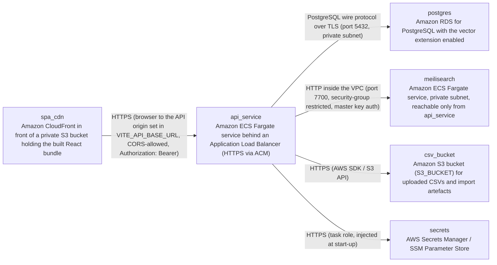

# Deployment Guide

> Maintained by QuorQ AI SDLC. Text between `sdlc:auto` markers is regenerated; anything outside them is yours and is kept.

<!-- sdlc:auto:start how-it-deploys -->
Pushes to `main` run `.github/workflows/deploy.yml`, which builds the API image (if there is a backend) and deploys the SPA to AWS Amplify. Commits touching only `docs/sdlc/**` don't deploy. Deployments can also be started from the platform's Deployment tab.
<!-- sdlc:auto:end how-it-deploys -->

<!-- sdlc:auto:start environments -->
| Name | Service | Runtime | Scaling | Environment |
|---|---|---|---|---|
| spa_cdn | Amazon CloudFront in front of a private S3 bucket holding the built React bundle | Static assets (React 19 production build) | CDN-managed, no instances | dev |
| api_service | Amazon ECS Fargate service behind an Application Load Balancer (HTTPS via ACM) | Python 3.12 container running FastAPI 0.115 under uvicorn | 1 task in dev, 1 vCPU / 2 GB — the rebuild is CPU-bound and runs in-process, so the task is sized for it; horizontal scaling by task count later | dev |
| postgres | Amazon RDS for PostgreSQL with the vector extension enabled | PostgreSQL 16 | Single db.t4g.medium instance, 50 GB gp3, storage encrypted at rest, automated daily backups, 7-day PITR | dev |
| meilisearch | Amazon ECS Fargate service, private subnet, reachable only from api_service | Container getmeili/meilisearch:v1.10.3 with an EFS volume for the index | 1 task, 0.5 vCPU / 1 GB — index of 50,000 titles only | dev |
| csv_bucket | Amazon S3 bucket (S3_BUCKET) for uploaded CSVs and import artefacts | Object storage, SSE-S3 encryption, public access blocked, versioning on | Managed | dev |
| secrets | AWS Secrets Manager / SSM Parameter Store | Holds DATABASE_URL, MEILI_MASTER_KEY, SEED_ADMIN_PASSWORD and the AWS credentials for S3 | Managed | dev |
<!-- sdlc:auto:end environments -->

<!-- sdlc:auto:start live -->
_Not deployed yet._
<!-- sdlc:auto:end live -->

<!-- sdlc:auto:start topology -->

<!-- sdlc:auto:end topology -->
